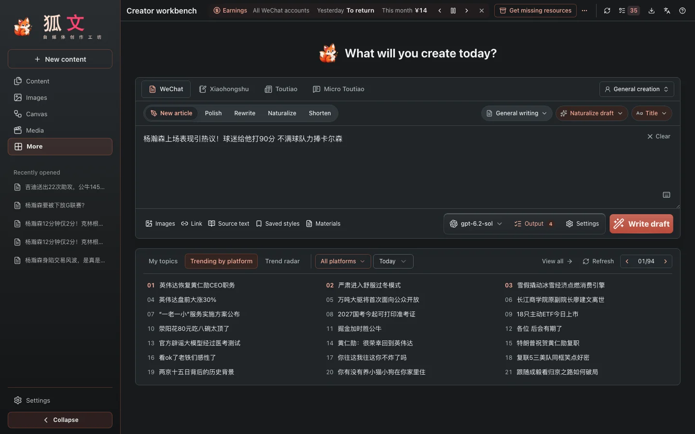
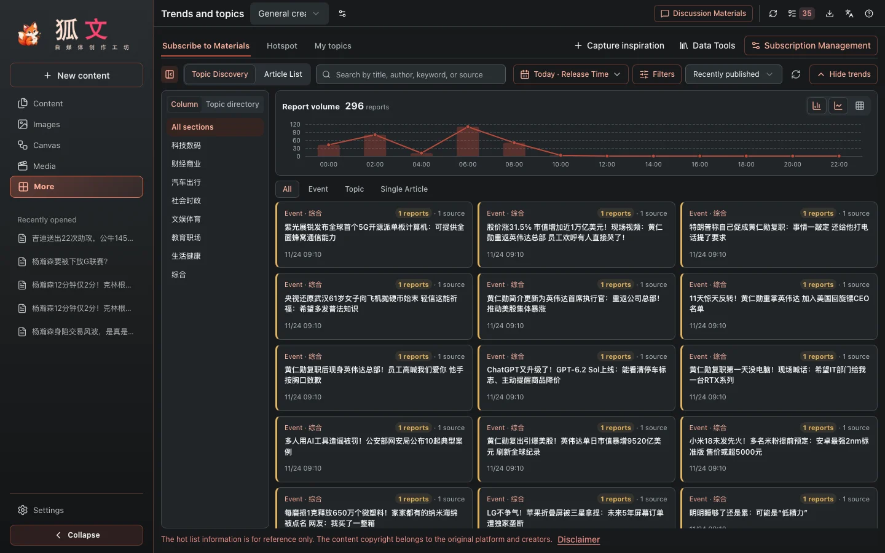
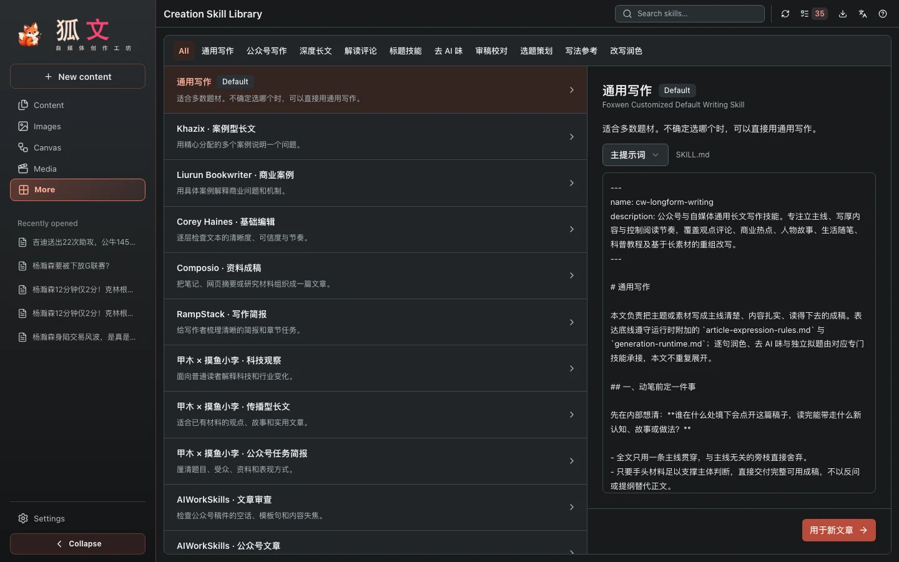
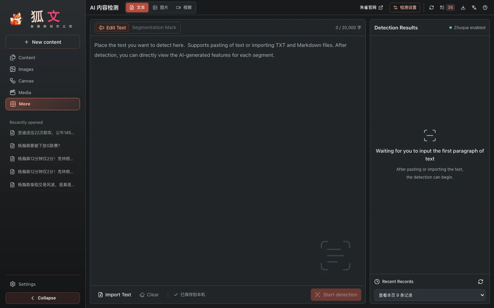
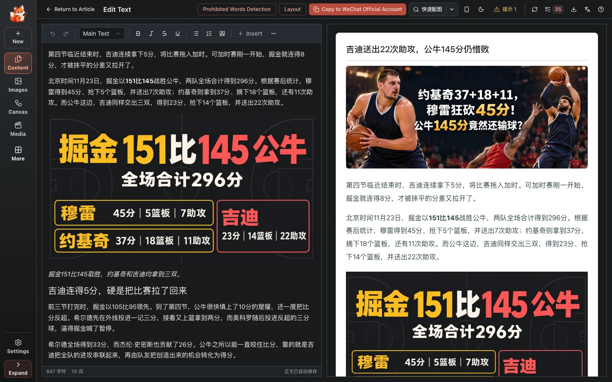
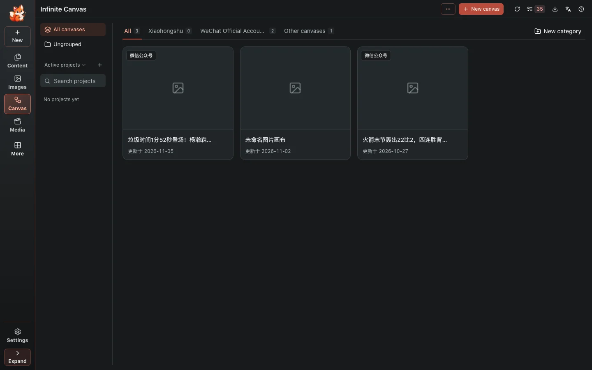
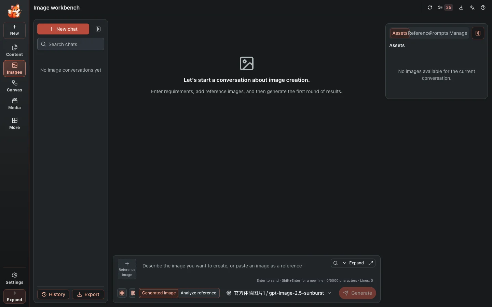
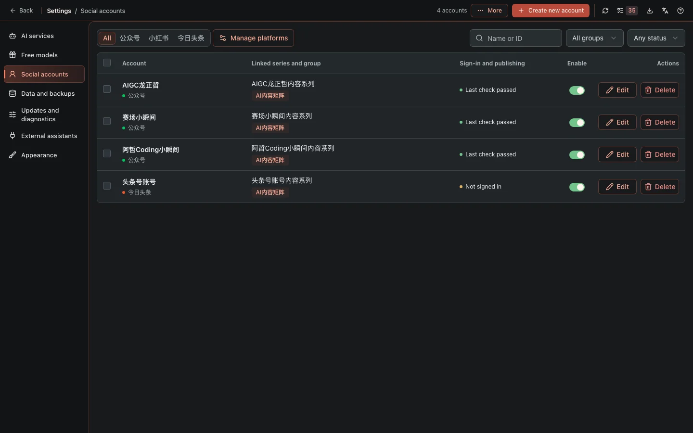
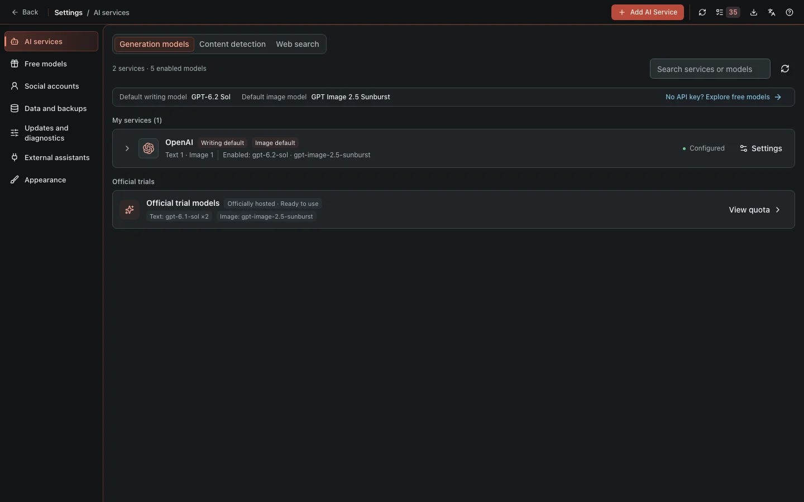

<div align="center">


# Huwen · 狐文

**Turn Inspiration into Content, Create in One Flow**

A local-first desktop AI writing & content operations workbench for creators and content teams (macOS & Windows).

[简体中文](./README.md) | **English**

[](https://github.com/wendaoai/wendao-content-workbench/releases/latest)
[](https://github.com/wendaoai/wendao-content-workbench/releases)
[](https://github.com/wendaoai/wendao-content-workbench/stargazers)
[](https://www.asfop.top/en/#download)
[](./README.md)

[](https://goframe.org/)
[](https://wails.io/)
[](https://react.dev/)
[](https://www.sqlite.org/)

[Official Website](https://www.asfop.top/en/#download) · [GitHub Releases](https://github.com/wendaoai/wendao-content-workbench/releases/latest) · [GitCode Releases](https://gitcode.com/wendao-ai/wendao-ai-updates/releases) · [Gitee Mirror](https://gitee.com/wendaoai/wendao-content-workbench/releases) · [All Features](https://www.asfop.top/en/features/) · [Changelog](https://www.asfop.top/en/updates/) · [Help Docs](https://ccnczqdy0ar6.feishu.cn/wiki/KcBAwnmFJiugFtkgIqlcccr3nPg) · [Issues](https://github.com/wendaoai/wendao-content-workbench/issues)

</div>

<br />



> All interface screenshots on this page are captured directly from **v0.0.236** in English UI mode. Click any image to view full size.

[Workflow in English](https://www.asfop.top/en/#workflow) · [中文创作流程](https://www.asfop.top/#workflow)

---

## Why Huwen

| Pillar | Highlights |
| --- | --- |
| **Local-First & Under Your Control** | Built as a native desktop app with Wails, GoFrame, and SQLite. Drafts, version history, knowledge bases, media assets, and canvas projects stay on your machine. |
| **End-to-End Content Studio** | Go from trend discovery, skill-driven drafting, section-by-section refinement, and smart formatting to Xiaohongshu visual posts, editable multi-page posters, Infinite Canvas, Layer Motion, and video editing. |
| **Bring Your Own Models** | Connect DeepSeek, OpenAI, Claude, Gemini, or any OpenAI-compatible gateway, browse the built-in **OpenRouter free model catalog**, or start with available trial quotas. |
| **Native Bilingual Desktop** | Switch between English and Simplified Chinese directly from the top toolbar—workspace views, canvases, window titles, and native desktop menus update together. |

---

## Six Steps from Spark to Delivery

| Step | Stage | What You Can Do |
| :---: | --- | --- |
| **01** | **Discover** | Scan an 8-category desktop news feed, platform rankings, trend charts, RSS/Atom feeds, and account samples to lock in strong angles. |
| **02** | **Draft** | Pick platform, account, model, and writing skill on the Home Composer; attach local knowledge docs and optional web search to generate drafts. |
| **03** | **Refine** | Run two-stage per-block streaming refinement (*Expression Cleanup* and *Natural Expression*), plus on-demand AI detection, quality review, and prohibited-word checks. |
| **04** | **Format & Visuals** | Edit Markdown beside live formatted themes, then branch the same piece into Xiaohongshu visual cards, knowledge cards, and editable multi-page posters. |
| **05** | **Canvas & Motion** | Organize reference images and product marketing sets on Infinite Canvas, iterate visuals in Image Studio, and extend into Layer Motion graphics and video timelines. |
| **06** | **Matrix & Deliver** | Manage accounts, series, and publishing status in Account Matrix; automate scheduled draft prep (`Asia/Shanghai`), push drafts, hand off via browser extension, or export offline. |

---

### 01 · Hotspots, News Feeds & Topic Planning

Aggregate an 8-category desktop news stream, platform rankings, hourly trend charts, marketing calendars, and RSS/Atom subscriptions with multi-source deduplication and bookmarks. Pair topic discovery with account analysis and send selected angles straight into writing.

> [Hotspots & Topic Discovery](https://www.asfop.top/en/features/topic-planning/) · [Learning Library](https://www.asfop.top/en/features/learning-library/)



---

### 02 · Skill-Driven Drafting, Web Search & Custom Skills

Start from a topic with attached references, links, images, or knowledge base notes, and toggle web search when you need live sources preserved alongside your draft. Built-in general writing splits commentary, storytelling, tutorials, and long-material rewrites into inspectable reference cards.

Import your own **custom writing skills from a ZIP archive or local folder**, manage and edit them in the Skills Library, and choose specialized tracks for video narration, short-video scripts, e-commerce marketing, social notes, and private-domain operations.

> [AI Article Writing](https://www.asfop.top/en/features/ai-writing/) · [Creation Templates & Skills](https://www.asfop.top/en/features/creation-templates/) · [Series Writing](https://www.asfop.top/en/features/series-writing/)



---

### 03 · Section-by-Section Refinement, AI Detection & Compliance Checks

- **Two-Stage Block Refinement**: *Expression Cleanup* removes repetitive recaps and boilerplate phrasing first, followed by *Natural Expression* concurrent streaming per block—with side-by-side diffs, pause/resume, and manual adoption.
- **Independent Detection & Quality Review**: Run Tencent Zhuque AI content detection on demand (inside an article or in the standalone workspace via paste / TXT / Markdown import) to inspect segment classifications, alongside a separate Quality Review with rubric scores, quotes, and editorial suggestions. Neither promises fixed human percentages or overwrites drafts without approval.
- **Prohibited-Word Check**: Run local compliance checks on WeChat and Xiaohongshu drafts with inline replacement previews, undo support, custom personal lexicons, and optional third-party re-checks.

> [Section Refinement](https://www.asfop.top/en/features/article-rewrite/) · [AI Content Detection](https://www.asfop.top/en/features/ai-detection/) · [Quality Review](https://www.asfop.top/en/features/quality-review/) · [Content Checks](https://www.asfop.top/en/features/content-checks/)



---

### 04 · Smart Formatting, Xiaohongshu Visuals & Editable Posters

Edit Markdown on the left while previewing formatted WeChat Official Account themes on the right. Copy rich text, export self-contained HTML with images, or hand off to WeChat draft flows.

Turn any draft into **Xiaohongshu visual notes**, **knowledge cards**, and **multi-page editable posters** using the shared multi-page layer editor—complete with guides, snapping, format painter, undo/redo, and editable text, images, charts, tables, and QR codes. Export as PNG, JPG, PDF, long scrolling images, or 9-grid sets.

> [Smart Formatting](https://www.asfop.top/en/features/wechat-layout/) · [Xiaohongshu Visuals](https://www.asfop.top/en/features/xiaohongshu/) · [Multi-Page Posters](https://www.asfop.top/en/features/multi-page-posters/) · [Card Studio](https://www.asfop.top/en/features/card-maker/)



---

### 05 · Infinite Canvas & AI Image Studio

- **Infinite Canvas**: Organize articles, visual references, creative plans, product marketing sets, and multi-page posters by platform and project. Trace every asset back to its source and save proven node graphs as versioned workflow templates.
- **AI Image Studio**: Paste reference images directly into multi-turn conversational image generation, track task history and retries, batch-compress images locally with Smart Compression, and create AI stickers or HD wallpapers.

> [Infinite Canvas](https://www.asfop.top/en/features/canvas/) · [AI Image Studio](https://www.asfop.top/en/features/image-studio/) · [Product Image Sets](https://www.asfop.top/en/features/product-images/) · [Stickers](https://www.asfop.top/en/features/stickers/) · [Wallpapers](https://www.asfop.top/en/features/wallpaper/)





---

### 06 · Account Matrix, Scheduled Prep & Publishing Handoff

Manage WeChat Official Accounts, Xiaohongshu, Toutiao, and other platform accounts in one redesigned Account Matrix—filter by platform, inspect linked series and login/publishing status, and configure WeChat connections directly inside the account drawer.

- **Scheduled Creation**: Configure recurring draft schedules (aligned to `Asia/Shanghai` time) so drafts are generated automatically into your library, ready for human review and publishing.
- **Flexible Delivery**: Export illustrated HTML, clean Markdown, PNG cards, and PDFs through the unified Download Center, push drafts to connected WeChat accounts, or hand off content via the browser Publish Assistant.

> [Account Matrix & Operations](https://www.asfop.top/en/features/account-operations/) · [Scheduled Creation](https://www.asfop.top/en/features/scheduled-writing/) · [Draft Push & Handoff](https://www.asfop.top/en/features/publishing/) · [Export & Download Center](https://www.asfop.top/en/features/export-download/)



---

## More Creative & Production Capabilities

<details>
<summary><strong>AI Companion & Native Agent Workflows</strong></summary>

- **Dedicated Companion Chat**: Search public web pages, read articles, look up workspace materials, create real drafts, refine copy with chosen skills, generate new images from chat assets, and jump straight into the layer editor to adjust covers.
- **Direct Motion & Video Creation**: Generate editable native motion projects, sand-art animations, and MP4 exports from articles, prompts, or images, or invoke configured cloud video providers—with full task and asset links preserved across refreshes.
- **Native Agent & Open Interfaces**: Plan productions, assist timeline edits, and run expert critiques with preview-before-apply confirmation. Exposes HTTP, CLI, and MCP interfaces with resumable task receipts.

> [Explore Companion Assistant](https://www.asfop.top/en/features/companion/)

</details>

<details>
<summary><strong>Layer Motion, Media Studio, PDF/PPTX-to-Video & 3D Director Stage</strong></summary>

- **Article & Document-to-Video**: Convert articles or **PDF/PPTX material workspaces** (preserving original files, per-page text, images, and OCR for scanned pages) into editable video projects—including editable **trend chart and decision flowchart shots** with independent landscape/portrait variants. Includes hand-drawn pen explainer, warm-gold product showcase, modular collage, documentary, sand-art story, and gold-line reveal styles.
- **Layer Motion Editor**: Edit scenes, typography, images, keyframes, audio tracks, and subtitles; import Lottie JSON / dotLottie animations; save personal presets and render MP4 in the background.
- **Media Studio & Timeline Editing**: Connect scripts, storyboards, image/video generation, AI upscaling, and local Eagle asset lookup. The timeline supports trimming, splitting, multi-sequence & compound clips, track mixing, waveforms, color scopes, proxy preview, keyframe curves, SRT re-segmentation, and WebM / WAV / M4A / MP4 export.
- **Consistent Characters & Voice Cloning**: Reuse character sheets and visual styles across shots; pair with system voices or authorized voice-cloning providers.
- **3D Director Stage & Infographic Series**: Direct 3D scenes, models, lighting, cameras, skeletal poses, and keyframes with background rendering, or batch-render editable comparison, process, checklist, and chart infographic videos.

> [Layer Motion & Graphic Video](https://www.asfop.top/en/features/motion-graphics/)

</details>

<details>
<summary><strong>Local Knowledge Base, Resource Market & Utilities</strong></summary>

- **Content Library & Assets**: Browse all articles, visual designs, canvases, HTML files, images, videos, and social copy in one searchable catalog with version history and portable media project bundles.
- **Resource Market & Packs**: Browse and install prompts, writing skills, layout/image templates, editable video project packs, on-demand fonts, music/SFX, and Lottie assets—or download standalone ZIP packs for offline import. Huwen ships without bundled font files and defaults to system fonts.
- **Local Toolbox & Usage Analytics**: Includes local batch Smart Compression, ZIP/RAR/7z extraction, and a Model Usage dashboard tracking calls, tokens, and estimated costs by date, model, and task type.

> [Assets & Knowledge Base](https://www.asfop.top/en/features/assets-knowledge/) · [Content Library](https://www.asfop.top/en/features/content-library/) · [Resource Market](https://www.asfop.top/en/features/resource-center/)

</details>

---

## Quick Start

### 1. Download & Install

Official installers are published across the channels below. Visit the [Official Download Page](https://www.asfop.top/en/#download) to pick your OS and chip architecture:

| Platform | Architecture | Package | Installation |
| --- | --- | --- | --- |
| **macOS** | Apple Silicon (M-series) / Intel (x64) | `.dmg` | Open the DMG and drag **Huwen** into **Applications** |
| **Windows** | x64 (Intel / AMD) / ARM64 | `.zip` | Extract the full archive and launch `狐文.exe` inside the folder (keep resource files together) |

- **Download Channels**: [Official Site](https://www.asfop.top/en/#download) · [GitHub Releases](https://github.com/wendaoai/wendao-content-workbench/releases/latest) · [GitCode Releases](https://gitcode.com/wendao-ai/wendao-ai-updates/releases) · [Gitee Releases](https://gitee.com/wendaoai/wendao-content-workbench/releases)
- **macOS First Launch Note**: If a test build without Apple notarization is blocked on first launch, open **System Settings → Privacy & Security**, locate Huwen, and click **Open Anyway**.

### 2. Configure AI Services

Open **Settings → AI Services** to connect your preferred models, or begin with available trial quotas:

- **Streamlined Setup**: Verify credentials and fetch available models before saving, auto-recognize relay gateway configs, and inspect default text/image models at a glance.
- **OpenRouter Free Model Catalog**: Query and pick free models from OpenRouter directly inside settings.
- **Broad Compatibility**: Supports DeepSeek, OpenAI, Claude, Gemini, and OpenAI-compatible gateways. Usage and billing for text, image, voice, music, video, web search, and external detection follow each provider's rules.

> [Model & Desktop Settings](https://www.asfop.top/en/features/model-settings/)



### 3. Optional: Browser Publish Assistant

Available for **Chrome, Edge, and Firefox**. Transfers titles, formatted bodies, covers, and images from Huwen into WeChat Official Account, Zhihu, or Xiaohongshu editor pages—removing repetitive copy-pasting. The extension never auto-logs in, auto-saves drafts, or clicks publish; final confirmation always stays with the author.

> [Download Extension & Setup Guide](https://ccnczqdy0ar6.feishu.cn/wiki/H9Jmw1U0Oi9Ylik3jqCcbf9jnGd)

---

## Local Architecture & Privacy

```text
Wails v2 Native Desktop App
  ├── Embedded React 19 Bilingual UI (English / 简体中文)
  ├── Local GoFrame v2 / Go Backend Service
  └── Local SQLite Database & User Data Directory (content.db / backups / logs / outputs)
```

- **Local Storage**: Drafts, assets, version history, knowledge bases, and project files are stored in your system user data directory and persist across app upgrades (backing up the data directory before major upgrades is still recommended).
- **External Request Boundary**: Data is sent to external providers only when you invoke a configured AI model, web search, third-party detection service, or publishing connector for that specific task.

---

## Feedback & License

- If Huwen helps your workflow, please consider giving us a **Star** on [GitHub](https://github.com/wendaoai/wendao-content-workbench).
- Report bugs or share suggestions in [GitHub Issues](https://github.com/wendaoai/wendao-content-workbench/issues). Include your OS, app version, and reproduction steps—**never upload API keys, account credentials, or private drafts**.
- Huwen is closed-source desktop software. This repository hosts public product documentation, release assets, and distribution metadata; application source code is not included. All rights to text, screenshots, and brand assets are reserved.

Copyright (c) 2026 Content Workbench. All rights reserved.
