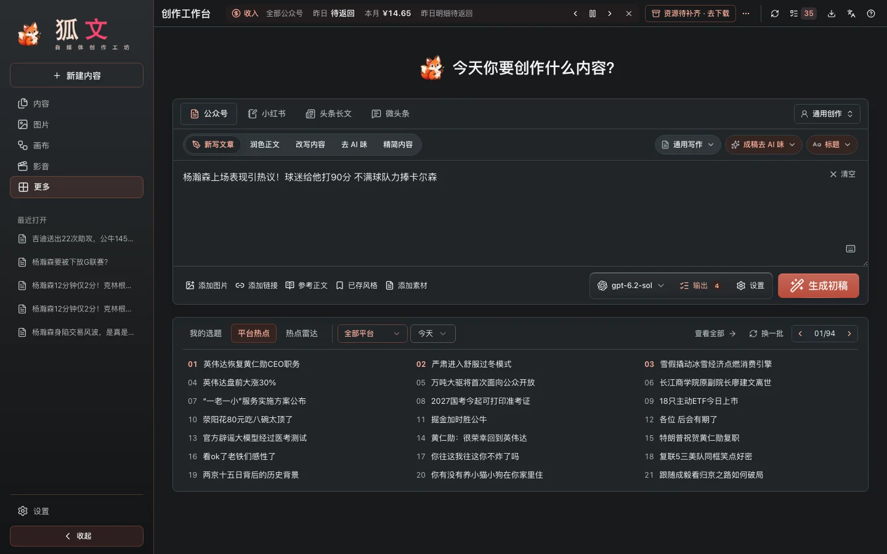
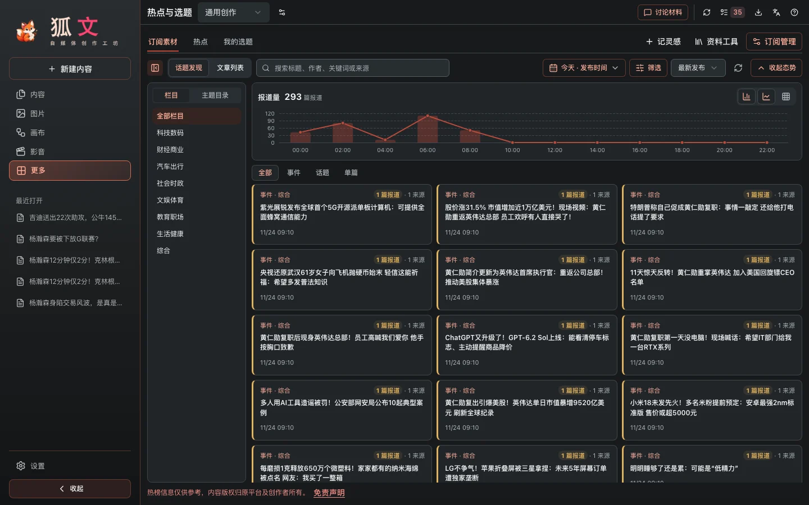
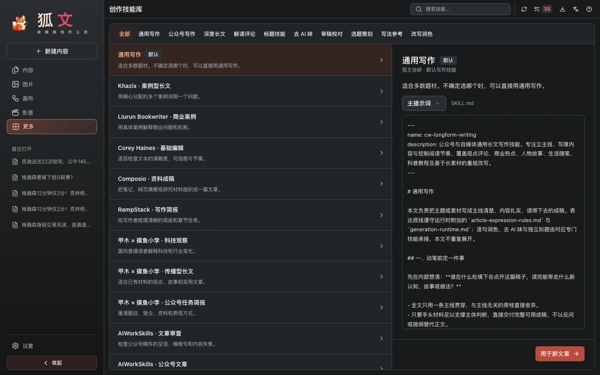
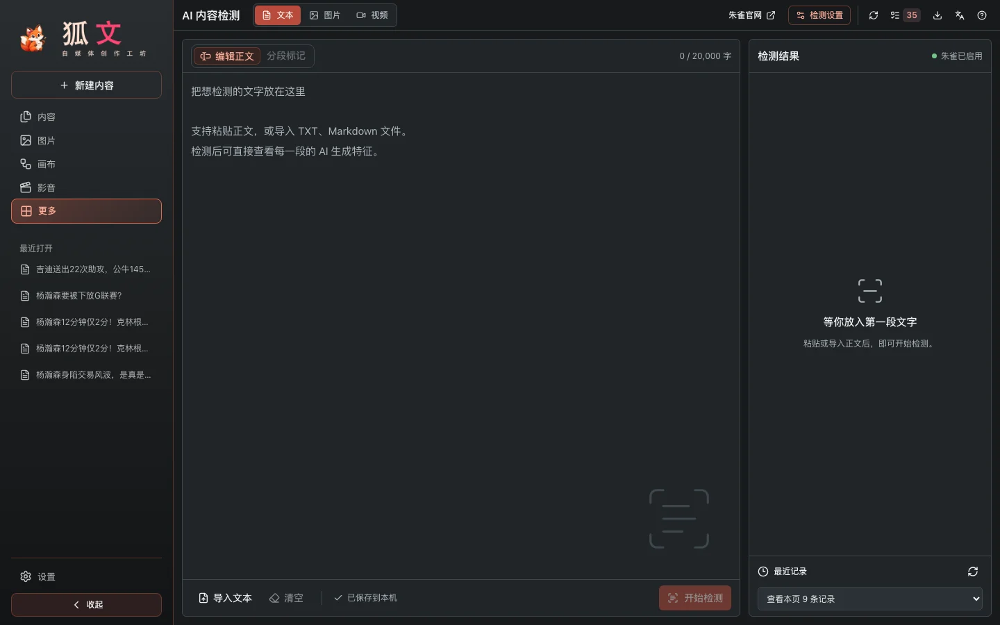
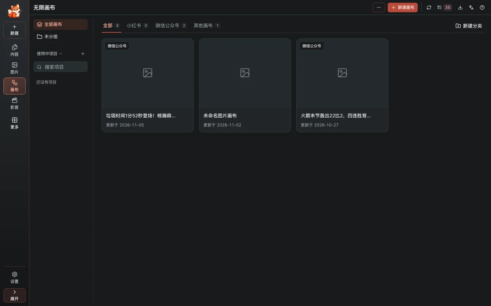
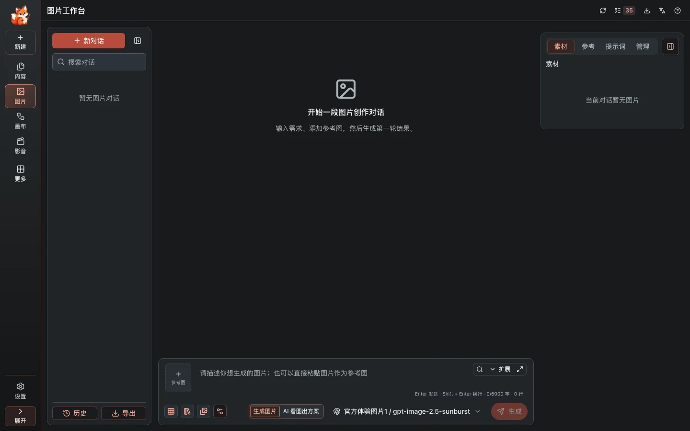
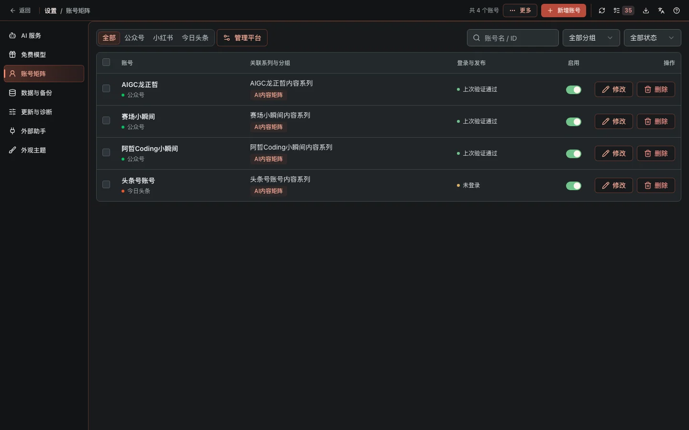
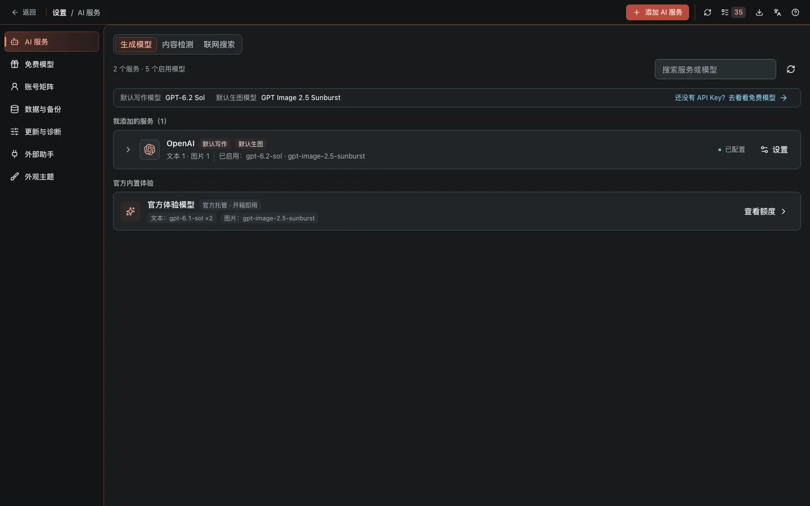

<div align="center">


# 狐文 · Huwen

**把灵感变成内容，让创作一步到位**

面向自媒体创作者与内容团队的本地桌面 AI 创作工坊（macOS & Windows）

**简体中文** | [English](./README.en.md)

[](https://github.com/wendaoai/wendao-content-workbench/releases/latest)
[](https://github.com/wendaoai/wendao-content-workbench/releases)
[](https://github.com/wendaoai/wendao-content-workbench/stargazers)
[](https://www.asfop.top/#download)
[](./README.en.md)

[](https://goframe.org/)
[](https://wails.io/)
[](https://react.dev/)
[](https://www.sqlite.org/)

[官网下载](https://www.asfop.top/#download) · [GitHub Releases](https://github.com/wendaoai/wendao-content-workbench/releases/latest) · [GitCode Releases](https://gitcode.com/wendao-ai/wendao-ai-updates/releases) · [Gitee 镜像](https://gitee.com/wendaoai/wendao-content-workbench/releases) · [全部功能](https://www.asfop.top/features/) · [更新日志](https://www.asfop.top/updates/) · [使用帮助](https://ccnczqdy0ar6.feishu.cn/wiki/KcBAwnmFJiugFtkgIqlcccr3nPg) · [问题反馈](https://github.com/wendaoai/wendao-content-workbench/issues)

</div>

<br />



> 以上及下文界面截图均采自 **v0.0.236** 桌面端真实界面，点击可查看大图。

[中文创作流程](https://www.asfop.top/#workflow) · [Workflow in English](https://www.asfop.top/en/#workflow)

---

## 核心特性一览

| 维度 | 能力说明 |
| --- | --- |
| **本地优先，数据可控** | 基于 Wails + GoFrame + SQLite 的原生桌面应用。稿件、版本历史、知识库、素材与画布工程默认保存在本机，随时备份与迁移。 |
| **全链路内容工坊** | 覆盖热点与资讯发现、技能直写、逐节去 AI 味、智能排版、小红书图文、多页可编辑海报、无限画布、图层动效与影音剪辑。 |
| **自由配置 AI 模型** | 支持接入 DeepSeek、OpenAI、Claude、Gemini 及兼容中转网关，内置 **OpenRouter 免费模型目录**，也可先用体验额度上手。 |
| **原生中英文双语界面** | 顶部工具栏一键切换简体中文与英文，工作台、画布、窗口标题与桌面菜单同步更新。 |

---

## 六步串起完整创作链路

| 步骤 | 环节 | 你可以直接完成 |
| :---: | --- | --- |
| **01** | **热点洞察** | 浏览 8 栏目桌面资讯流、平台热榜、趋势图、RSS/Atom 订阅与账号样本分析，锁定选题切入点。 |
| **02** | **技能直写** | 在创作首页直选目标平台、账号、模型与写作技能，挂接知识库资料与联网搜索生成初稿。 |
| **03** | **逐节打磨** | 独立执行「表达净化」与「自然表达」分块流式润色，按需运行腾讯朱雀 AI 检测、质量评分与违禁词修订。 |
| **04** | **排版图文** | 双栏实时预览公众号排版主题，一键延展为小红书图文笔记、知识卡片与多页可编辑海报。 |
| **05** | **画布动效** | 在无限画布串联参考图与营销套图，在图片工作台对话出图，并延展为图层动效、图解视频与影音成片。 |
| **06** | **矩阵交付** | 通过账号矩阵管理多平台系列与发布状态，支持上海时间定时自动备稿、公众号草稿推送、浏览器插件交接与离线导出。 |

---

### 01 · 热点洞察、订阅资讯与选题规划

聚合 8 栏目桌面资讯流、平台热榜、时段趋势图、营销日历与 RSS/Atom 订阅源，支持多源去重、收藏筛选与阅读讨论；结合账号分析与选题工作台，选定切入角度后可直接带入创作。

> [热点与选题规划](https://www.asfop.top/features/topic-planning/) · [学习资料库](https://www.asfop.top/features/learning-library/)



---

### 02 · 技能直写、联网搜索与自定义写作技能库

输入主题并挂接参考文章、链接、图片或本地知识库资料，按需开启联网搜索保留结果与来源。通用写作拆分为评论、故事、教程与长素材改写参考卡，支持在首页与技能库直接预览。

支持从 **ZIP 或本地文件夹** 导入自定义写作技能，并在技能库中管理、编辑与复用；内置专业写作赛道覆盖视频解说、短视频口播、电商营销、社交笔记与私域运营等场景。

> [AI 文章写作](https://www.asfop.top/features/ai-writing/) · [创作模板与写作技能](https://www.asfop.top/features/creation-templates/) · [系列内容创作](https://www.asfop.top/features/series-writing/)



---

### 03 · 逐节打磨、AI 内容检测与违禁词修订

- **双阶段逐节润色**：「狐文 · 表达净化」先清理重复总结与套话，「狐文 · 自然表达」按检测块并发流式改写，支持版本对比、停止续做与手动逐块采用。
- **独立检测与审稿**：按需运行腾讯朱雀 AI 内容检测（查看人工、疑似 AI、AI 分块分类，也支持独立工作区粘贴或导入 TXT/Markdown）；文章质量评分另行提供维度依据、原文引文与编辑建议。两者独立呈现，均不承诺固定人工率，也不自动覆盖原稿。
- **违禁词检测**：公众号文章与小红书文案均支持本地违禁词定位、逐处预览替换与撤销，支持维护个人词库及按配置选择第三方复检。

> [逐节表达改写](https://www.asfop.top/features/article-rewrite/) · [AI 内容检测](https://www.asfop.top/features/ai-detection/) · [独立质量评分](https://www.asfop.top/features/quality-review/) · [违禁词检查](https://www.asfop.top/features/content-checks/)



---

### 04 · 公众号智能排版、小红书图文与多页可编辑海报

左侧编辑 Markdown、右侧实时预览多种公众号排版主题，完成后可直接复制图文、导出带图 HTML，或推送至公众号草稿箱。

同一篇稿件可继续拆分与重排为**小红书图文笔记**、**知识卡片**与**多页可编辑海报**。卡片工坊、海报与图文设计共用统一多页图层编辑器，支持参考线、吸附、格式刷、撤销重做，以及文字、图片、图表、表格与二维码的逐项微调，按用途导出 PNG、JPG、PDF、长图或九宫格。

> [公众号智能排版](https://www.asfop.top/features/wechat-layout/) · [小红书图文笔记](https://www.asfop.top/features/xiaohongshu/) · [多页可编辑海报](https://www.asfop.top/features/multi-page-posters/) · [图文卡片工坊](https://www.asfop.top/features/card-maker/)


---

### 05 · 无限画布、AI 图片工作台与视觉工坊

- **无限画布**：按平台与项目组织文章、风格参考、视觉策划、产品营销套图与多页海报节点，创作脉络清晰可回溯，支持将已完成步骤保存为固定版本工作流模板。
- **AI 图片工作台**：直接粘贴参考图进行多轮对话生图，统一管理生成任务、历史结果与失败重试；内置本地批量智能压缩，同时提供 AI 表情包与高清壁纸制作入口。

> [无限画布](https://www.asfop.top/features/canvas/) · [AI 图片工作台](https://www.asfop.top/features/image-studio/) · [产品营销套图](https://www.asfop.top/features/product-images/) · [表情包](https://www.asfop.top/features/stickers/) · [壁纸生成](https://www.asfop.top/features/wallpaper/)





---

### 06 · 多账号矩阵、定时备稿与发布交接

重整后的账号矩阵在一个列表内统一管理公众号、小红书、今日头条等平台账号，直观查看关联系列、分组及登录发布状态，公众号连接在抽屉内一站配置。

- **定时自动备稿**：按上海时间（`Asia/Shanghai`）设置频率与创作要求，到点自动生成草稿进入内容库，由作者审阅润色后发布。
- **多方式交付**：支持带图 HTML、纯 Markdown、高清 PNG/PDF 离线导出与下载中心统一管理；支持公众号草稿推送（需相应账号权限）及浏览器发布助手交接。

> [多账号运营与分析](https://www.asfop.top/features/account-operations/) · [定时创作计划](https://www.asfop.top/features/scheduled-writing/) · [草稿与发布交接](https://www.asfop.top/features/publishing/) · [离线导出与下载中心](https://www.asfop.top/features/export-download/)



---

## 更多创作与工程能力

<details>
<summary><strong>小助手（AI Companion）与原生 Agent 工作流</strong></summary>

- **独立对话工作区**：支持查公开网页、读文章、检索工作台资料、创建真实草稿、按选定技能改稿、基于对话素材生成新图并打开图层编辑器修改封面。
- **视频与动效直出**：支持按文章、主题或图片创建原生动效工程、可编辑沙画与 MP4，或调用已配置的云端视频服务；对话完整保留关联资料、任务和作品入口。
- **原生 Agent 与开放入口**：支持制作计划准备、辅助剪辑与专家批改（先预览方案再确认采用）；提供 HTTP、CLI 与 MCP 能力入口，任务回执支持中断后查询与恢复。

> [了解小助手](https://www.asfop.top/features/companion/)

</details>

<details>
<summary><strong>图层动效、影音工作室、PDF/PPTX 资料转视频与 3D 导演台</strong></summary>

- **文章与文档一键转可编辑视频**：支持文章与 PDF/PPTX 资料工作区（保留原文件、逐页文字与原图，支持扫描页识别），新增可编辑的**趋势图与判断流程图镜头**，支持横屏/竖屏副本独立微调。内置钢笔手绘讲解、暖金卡片产品宣传、模块拼贴、数字城市光场、人文纪录片、沙画故事与金线显影等风格。
- **图层动效编辑器**：编辑场景、文字、图片、关键帧、音轨与字幕，支持导入 Lottie JSON / dotLottie 动画与保存个人预设，后台任务导出 MP4。
- **影音工作室与时间轴剪辑**：统一组织剧本、分镜、参考图生图、视频生成、AI 超分与 Eagle 本地素材检索；时间轴支持裁剪、分割、多序列与复合片段、轨道混音、波形、调色示波器、代理预览、关键帧曲线与 SRT 字幕重分段，支持 WebM / WAV / M4A / MP4 导出。
- **固定角色与声音克隆**：为项目保存角色参考与画风；支持系统音色及授权样本的声音克隆服务。
- **3D 导演台与图解系列**：在 3D 导演台组织场景、模型、灯光、机位、骨骼姿态与关键帧并后台渲染；图解系列支持对比、流程、清单与数值图表批量渲染。

> [图层动效与动态信息图](https://www.asfop.top/features/motion-graphics/)

</details>

<details>
<summary><strong>本地知识库、资源市场与实用工具</strong></summary>

- **内容库与产品资产**：全部作品目录汇总文章、图文设计、画布、HTML、图片、视频与平台文案，支持搜索筛选与返回原编辑器；保留系列与历史版本，影音作品支持打包迁移。
- **资源市场与独立资源包**：提供提示词、写作技能、排版/图片模板、视频工程模板、按需字体、视觉素材、音乐音效与 Lottie 动画，支持在线安装或下载独立 ZIP 离线导入。应用默认使用系统字体，不内置字体文件。
- **本地工具箱与用量统计**：内置本地批量图片智能压缩、ZIP/RAR/7z 解压工具，以及按日期、模型与用途统计的 Token 用量与费用估算视图。

> [产品资产与知识库](https://www.asfop.top/features/assets-knowledge/) · [内容库与版本管理](https://www.asfop.top/features/content-library/) · [资源市场与资源包](https://www.asfop.top/features/resource-center/)

</details>

---

## 快速开始

### 1. 下载与安装

安装包在以下渠道同步发布，可前往 [官网下载页](https://www.asfop.top/#download) 按系统与芯片直接获取：

| 平台 | 架构 | 格式 | 安装方式 |
| --- | --- | --- | --- |
| **macOS** | Apple Silicon (M 系列) / Intel (x64) | `.dmg` | 打开 DMG，将「狐文」拖入「应用程序」文件夹启动 |
| **Windows** | x64 (Intel / AMD) / ARM64 | `.zip` | 解压完整文件夹后，双击运行目录内的 `狐文.exe`（勿单独拖出 exe） |

- **下载源**：[官网下载](https://www.asfop.top/#download) · [GitHub Releases](https://github.com/wendaoai/wendao-content-workbench/releases/latest) · [GitCode Releases](https://gitcode.com/wendao-ai/wendao-ai-updates/releases) · [Gitee Releases](https://gitee.com/wendaoai/wendao-content-workbench/releases)
- **macOS 首次打开提示**：若当前测试版未包含 Apple 开发者公证导致首次启动被拦截，请前往「系统设置 → 隐私与安全性」，找到狐文并点击「仍要打开」。

### 2. 配置 AI 服务

在工作台「设置 → AI 服务」中配置模型，也支持使用应用提供的体验额度快速试用：

- **快捷接入**：支持保存前自动验证并拉取可用模型列表、中转站配置识别与默认模型速览。
- **OpenRouter 免费模型目录**：可直接查询并选用 OpenRouter 提供的免费模型，无需额外整理模型 ID。
- **主流模型兼容**：支持 DeepSeek、OpenAI、Claude、Gemini 及各类 OpenAI 兼容接口；文本、生图、语音、音乐、视频、联网搜索与第三方检测均按实际配置及服务商规则计费。

> [AI 服务与模型设置](https://www.asfop.top/features/model-settings/)



### 3. 可选：浏览器发布助手

支持 **Chrome / Edge / Firefox**，可将工作台中的标题、正文、封面与配图交接到微信公众号、知乎或小红书编辑页，减少来回复制。插件不会自动登录、保存草稿或点击发布，最终确认始终由作者完成。

> [下载浏览器插件与安装教程](https://ccnczqdy0ar6.feishu.cn/wiki/H9Jmw1U0Oi9Ylik3jqCcbf9jnGd)

---

## 本地架构与数据隐私

```text
Wails v2 原生桌面应用
  ├── 内置 React 19 双语工作台界面（简体中文 / English）
  ├── 本地 GoFrame v2 / Go 业务服务
  └── 本地 SQLite 数据库与用户数据目录（content.db / backups / logs / outputs）
```

- **本机存储**：稿件、素材、历史版本、知识库与工程文件保存在系统用户目录中，升级或替换安装包不会覆盖你的创作数据（重大升级前仍建议备份数据目录）。
- **外部请求边界**：仅在你主动调用已配置的 AI 模型、联网搜索、第三方检测或发布服务时，才会向对应服务商发送该任务所需的数据。

---

## 反馈与声明

- 如果狐文对你的创作有帮助，欢迎在 [GitHub](https://github.com/wendaoai/wendao-content-workbench) 点一个 Star 支持我们。
- 欢迎在 [GitHub Issues](https://github.com/wendaoai/wendao-content-workbench/issues) 提交问题与功能建议；反馈时请附上操作系统、应用版本号与复现步骤，**请勿上传 API Key、账号凭据或私人稿件**。
- 狐文为闭源桌面软件，本仓库用于产品展示、公开资料与版本发布，不提供应用业务源码。文内文字、界面截图与品牌素材保留全部权利。

Copyright (c) 2026 Content Workbench. All rights reserved.
